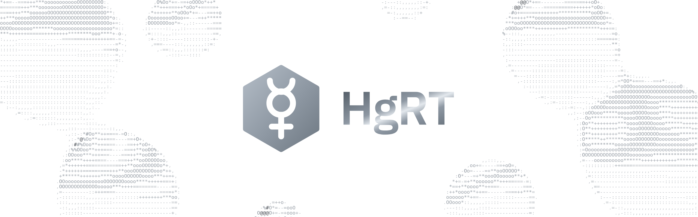

<div align="center">

<picture>
  <source media="(prefers-color-scheme: dark)" srcset="https://raw.githubusercontent.com/Minerva-Laboratories/HgRT/main/docs/assets/hgrt-banner-dark.png">
  
</picture>

### The Mercurius runtime and long-context stack

Single-sequence decode engines for Mercurius-0.5 and Mercurius-1-4B, and a long-context stack for the Qwen3.5 family,<br>
built for one small GPU (Jetson AGX Orin, a 6 GB laptop GPU) and measured there.

[](https://github.com/Minerva-Laboratories/HgRT/blob/main/LICENSE)
[](https://github.com/Minerva-Laboratories/HgRT/blob/main/pyproject.toml)
[](https://github.com/Minerva-Laboratories/HgRT/blob/main/pyproject.toml)
[](#results)
[](#limitations-and-open-bottlenecks)

[**Results**](#results) ·
[**Setup**](#setup) ·
[**Quickstart**](#quickstart) ·
[**How it works**](#how-it-works) ·
[**Mercurius report**](https://github.com/Minerva-Laboratories/HgRT/blob/main/results/mercurius/README.md) ·
[**All results**](https://github.com/Minerva-Laboratories/HgRT/blob/main/results/README.md)

[**FoveaKV**](https://github.com/Minerva-Laboratories/FoveaKV) ·
[**SparsePage**](https://github.com/Minerva-Laboratories/SparsePage) ·
[**DepthSkip**](https://github.com/Minerva-Laboratories/DepthSkip) ·
[**OpenDecider**](https://github.com/Minerva-Laboratories/OpenDecider)

</div>

---

HgRT (Python package `hgrt`) is the runtime that serves Minerva Laboratories' models on a single small GPU. It has two
parts, and they can be used separately:

- **The Mercurius-0.5 engine** (new in 0.2.0). It runs
  [Mercurius-0.5-4B-Preview](https://huggingface.co/Minerva-Laboratories/Mercurius-0.5-4B-Preview) straight from the
  exported checkpoint: Q4_0 / Q8_0 weights as stored, 24 GDN-2 and 8 CARE-latent MLA layers, and the **FoveaKV** cache
  the model was trained with. That cache holds 4-bit codes and takes 3.5x less memory than the exact cache. Decoding uses
  one CUDA graph per token and lossless MTP speculative decoding (1.7-1.8x), and prompts go through a batched prefill.
- **The Mercurius-1-4B engine.** Decoding runs from the model's exact deployed NF4 weights and its TurboQuant 4-bit KV
  cache. Each token is one CUDA graph. The engine uses exact NF4 GEMVs, a GDN-2 recurrent step, and absorbed MLA attention
  that reads the 4-bit cache codes directly. It also has lossless self-speculative decoding with the stock MTP head and a
  native tensor-core prefill.
- **The long-context stack** (Qwen3.5-9B). The prompt goes through **DepthSkip**, which gives tokens graded depth
  (old tokens stop early, and ridge maps write the caches of the upper layers). Its cache is stored as **FoveaKV** 2+2-bit
  pages. At each decoded token, **SparsePage** chooses which pages that token reads. **OpenDecider** makes typed decisions
  on the same stack. It never generates text, so only the prompt side applies.

The Mercurius-1-4B and long-context numbers below were measured on a **Jetson AGX Orin 64 GB in MODE_50W**. The GPU
clock is at most 816 MHz and the memory clock is DVFS-governed. The Mercurius-0.5 numbers come from an **RTX 4050 Laptop
GPU (6 GB)**. Other hardware will give different absolute numbers.

## Contents

- [Results](#results)
  - [Mercurius-0.5 (RTX 4050 Laptop)](#mercurius-05-rtx-4050-laptop)
  - [Mercurius-1-4B decode: plain vs MTP](#mercurius-1-4b-decode-plain-vs-mtp)
  - [Mercurius-1-4B prefill and memory](#mercurius-1-4b-prefill-and-memory)
  - [Long-context stack: decode attention](#long-context-stack-decode-attention)
  - [Long-context stack: long responses (graph-captured block encode)](#long-context-stack-long-responses-graph-captured-block-encode)
  - [Long-context stack: decode quality](#long-context-stack-decode-quality)
  - [Long-context stack: prefill and ordinary use](#long-context-stack-prefill-and-ordinary-use)
- [Setup](#setup)
- [Quickstart](#quickstart)
- [Environment variables](#environment-variables)
- [How it works](#how-it-works)
- [Repository layout](#repository-layout)
- [Testing](#testing)
- [Limitations and open bottlenecks](#limitations-and-open-bottlenecks)
- [Components](#components)
- [License](#license)

## Results

### Mercurius-0.5 (RTX 4050 Laptop)

Decode is in ms per generated token, with CUDA graphs, for 160 tokens after a 420-token prompt. **The MTP speculative
runs emitted exactly the plain greedy tokens.** The MLA cache figures are for a 32K context. Full tables, by context
length, are on the [Mercurius-0.5 results page](https://github.com/Minerva-Laboratories/HgRT/blob/main/results/mercurius-0.5/README.md).

| KV cache | plain | MTP k=2 | speed-up | MLA cache at 32K | top-1 vs pipeline reference |
|---|---:|---:|---:|---:|---:|
| exact | 21.8 | **10.7** | 2.03x | 292 MiB | 220/220 (KL 2.9e-4) |
| FoveaKV (as trained) | 22.9 | **11.8** | 1.94x | **80 MiB** | 218/220 (KL 2.0e-3) |

The batched prefill takes 0.6-0.8 s for a 512-token prompt (a 420-token prompt token by token: 9.3 s), 8.4 s at 8K,
19 s at 16K and 47 s at 32K; a 280-token prompt reaches its first token in 0.3 s. At 32K, FoveaKV decodes at 31.5 ms
per token (22.2 with MTP k=2), against 34.5 (23.6) for the exact cache, with
3.7x less cache memory.

### Mercurius-1-4B decode: plain vs MTP

Decode speed in tok/s for 256 greedy tokens after the prompt, with CUDA graphs. MTP uses the stock Qwen3.5-4B MTP head
(NF4, int8 MTP cache, GDN-2 commit fused into the next verification) and a draft vocabulary of 32k tokens. τ is the
number of tokens emitted per verification. **Every speculative run produced exactly the engine's plain greedy token
stream** (36/36 runs lossless).

| context (prompt tokens) | plain | MTP k=1 (τ) | MTP k=2 (τ) | MTP k=3 (τ) | MTP adaptive k | best MTP / plain |
|---|---:|---:|---:|---:|---:|---:|
| ~1K (1,006) | 38.6 | 60.5 (1.81) | 70.5 (2.46) | **72.1** (2.90) | 69.8 | 1.87x |
| ~8K (8,174) | 37.1 | 56.2 (1.79) | **62.3** (2.34) | 61.1 (2.68) | 58.7 | 1.68x |
| ~32K (32,750) | 32.7 | 46.3 (1.77) | **50.5** (2.34) | 48.9 (2.73) | 49.4 | 1.54x |
| chat, 6 prompts (26-42) | 38.9 | 54.0-65.5 | 53.6-79.5 | 51.1-88.6 | 53.1-86.4 | 1.39-2.28x |

Baselines on the same board, from the first-round table (`results/mercurius/README.md`). They decode the same context
lengths of ~1K / ~8K / ~32K:

| | ~1K | ~8K | ~32K |
|---|---:|---:|---:|
| deployed transformers path (OpenDecider `load_deployed`) | 2.48 | 2.52 | 1.24 |
| llama-mercurius (llama.cpp fork), same NF4 weights / IQ4_NL | 20.0 / 24.1 | 19.5 / 23.2 | 17.8 / 20.8 |
| **HgRT plain** | **38.6** | **37.1** | **32.7** |

<sub>Source: `results/mercurius/bench_v2.json` (current code), `results/mercurius/README.md` ("Decode before / after" and
"Decode speed" tables). The "best MTP / plain" ratios are computed from `bench_v2.json`. The 32k draft vocabulary
affects only drafting, because verification always uses the full head.</sub>

Where a plain token goes (ms, components timed alone in CUDA graphs):

| component | chat (T=27) | 8K | 32K |
|---|---:|---:|---:|
| 24 GDN-2 layers | 8.99 | 8.99 | 9.17 |
| 8 MLA layers | 2.59 | 3.82 | 7.53 |
| 32 MLPs | 10.53 | 10.77 | 12.52 |
| LM head (NF4, 248k rows) + argmax | 2.76 | 2.91 | 2.89 |
| **whole step, measured** | 25.95 | 27.30 | 30.75 |

<sub>Source: `results/mercurius/README.md` ("Per-token time, plain decode"). At short context, a plain token reads
≈ 2.8 GB, which is ≈ 108 GB/s effective against a read ceiling of ~150 GB/s in MODE_50W.</sub>

### Mercurius-1-4B prefill and memory

The native prefill needs neither the transformers model nor a snapshot.

| context | HgRT native | deployed transformers | llama-mercurius NF4 | HgRT peak GB | MTP k=2 lossless from native state |
|---|---:|---:|---:|---:|:---:|
| ~1K (1,006) | 578 tok/s | 953 tok/s | 538 tok/s | 3.52 | yes |
| ~8K (8,174) | 609 tok/s | 1025 tok/s | 551 tok/s | 4.03 | yes |
| ~32K (32,750) | 503 tok/s | 785 tok/s | 479 tok/s | 4.70 | yes |

Peak decode memory (GB): HgRT engine + MTP 3.31 / 3.31 / 3.35 / 3.46 at chat / ~1K / 8K / 32K (sized for 34k positions).
The deployed transformers path needs 3.46 / 3.61 / 4.92 / 9.46 GB.

<sub>Source: `results/mercurius/prefill.json` and `results/mercurius/README.md` ("Native prefill", "Memory"). The native
prefill is 1.6-1.8x slower than the transformers path. At 32K, its first token differs from the reference, at a point
where the reference has an exact tie (top-2 margin 0.000).</sub>

### Long-context stack: decode attention

Each value is one attention call over a synthetic cache with 4 KV heads and head_dim 256, replayed inside a CUDA graph
of 8 calls (the number of attention layers in Qwen3.5-9B). At 32K, the stack kernel matches its PyTorch reference with
an output error of 8.7e-7 and selects the same pages (Jaccard 1.0).

| context | bf16 kernel | FoveaKV 2-bit (gs2) | FoveaKV dyn10 | **stack 10%** | stack bits read / value |
|---|---:|---:|---:|---:|---:|
| 32K | 5.52 ms | 1.17 ms | 1.87 ms | **0.36 ms** | 0.735 |
| 128K | 21.57 ms | 3.77 ms | 5.96 ms | **0.80 ms** | 0.685 |
| 256K | 42.66 ms | 7.45 ms | 11.49 ms | **2.57 ms** | 0.675 |

<sub>Source: `results/stack_bench_h4.json` (`ms_graph_per_call`), produced by `experiments/stack_bench.py`. At 256K, the
stack's graph time in this file (2.57 ms) is above its eager time (1.42 ms). An earlier run, which the previous README
quoted, measured 1.45 ms. Treat the 256K stack value as noisy. These are attention-only numbers: the rest of a decode
step is reading the weights.</sub>

### Long-context stack: long responses (graph-captured block encode)

The stack encodes every 128 generated tokens into FoveaKV codes and SparsePage page summaries. That encode used to run
eagerly between graph replays, which caused a stall. It now replays from a captured CUDA graph and is bit-identical
to the eager encode (`tests/test_encode_graph.py`). The setup is the same as above (synthetic caches, 4 KV heads, 8
layers, attention and encode only), with 2,048 generated tokens:

| prompt | encode stall per 128 tokens (8 layers) | wall ms / generated token, eager encode | **wall ms / generated token, graph encode** | of which graph replay (median) |
|---|---:|---:|---:|---:|
| 1K | 142 ms → 16.6 ms | 2.94 | **2.17** | 1.46 ms |
| 32K | 142 ms → 16.6 ms | 4.53 | **3.69** | 2.85 ms |

<sub>Source: `results/profile/long_response.json` as committed in `6e51bab` (graph-encode values:
`encode_ms_per_encode_step`, `wall_ms_per_token`, `graph_ms_median`), produced by
`experiments/profile/long_response.py`. The eager-encode "before" values (142 ms, 2.94, 4.53) are from the message of
commit `13329eb`, which reports the stall as 142 → 17 ms. `HGRT_ENCODE_GRAPH=0` restores the eager encode.</sub>

### Long-context stack: decode quality

These runs use Qwen3.5-9B with an exact prefill. Then 256 tokens are teacher-forced through each decode cache, for prose
and code at 16K and 32K, with 3 documents each. ΔNLL has a 95% token bootstrap interval. The runs used the same kernels
in FoveaKV's harness, before the components were split into separate repositories.

| decode cache | bits read / value / step | ΔPPL | ΔNLL [95% CI] | worst document |
|---|---:|---:|---|---:|
| FoveaKV gs4 | 4.29 | +0.27% | +0.0027 [-0.0006, +0.0058] | +0.73% |
| FoveaKV dyn10 | 2.52 | +0.29% | +0.0028 [-0.0002, +0.0059] | +0.90% |
| **stack 20%** | 1.27 | +0.21% | +0.0021 [-0.0029, +0.0069] | +0.99% |
| **stack 10%** | 0.86 | +0.63% | +0.0062 [-0.0002, +0.0126] | +3.44% |
| stack 10%, bound only | 0.73 | +0.85% | +0.0083 [+0.0013, +0.0154] | +3.23% |
| stack 5% | 0.65 | +1.86% | +0.0181 [+0.0069, +0.0290] | +6.10% |

<sub>Source: `results/qwen3.5-9b/stack_ppl.jsonl` (`experiments/stack_ppl.py`). The bits, ΔNLL, ΔPPL (mean per-document
perplexity ratio) and worst-document values were checked against this file. The confidence intervals were not
recomputed.</sub>

### Long-context stack: prefill and ordinary use

**Prefill (DepthSkip, Qwen3.5-9B, serving kernels).** Compared with the exact prompt pass, cut 24 is 1.25-1.31x faster
and cut 16 is 1.67-1.86x faster, from 1K to 131K tokens. Graded depth **g512** gives the last 32 tokens all layers, the
480 tokens before them cut 24, and the rest cut 16. It keeps lettered multiple choice at the exact model's accuracy
(OBQA / CSQA 0.890 / 0.815 vs 0.885 / 0.815) with KL 0.024, where cut 16 has KL 0.094. At 15K tokens (eager attention),
g512 takes 15.0 s and the exact pass takes 21.5 s.
<sub>Source: [DepthSkip README](https://github.com/Minerva-Laboratories/DepthSkip) (`third_party/depthskip/README.md`).</sub>

**Ordinary use (partial run).** In this test, a prose document is summarized (128 new tokens) by Qwen3.5-9B through
`experiments/usage.py`. There is one document per length. The decode harness runs the layers in eager PyTorch (no CUDA
graph), so the ~180 ms/token is mostly Python overhead that every configuration shares. Only the bf16 row exists at
262K.

| prose prompt | config (prefill + decode) | time to first token | decode ms / token | KV cache | ROUGE-L vs exact answer |
|---|---|---:|---:|---:|---:|
| 32K | exact + bf16 | 65.2 s | 179.4 | 1.005 GB | – |
| 32K | exact + stack10 | 72.2 s | 180.0 | 0.290 GB | 0.38 |
| 32K | g512 + stack10 | 45.3 s | 180.3 | 0.290 GB | 0.39 |
| 131K | exact + bf16 | 518.8 s | 233.8 | 4.005 GB | – |
| 131K | exact + stack10 | 549.0 s | 180.5 | 1.116 GB | 0.65 |
| 131K | g512 + stack10 | 313.5 s | 180.3 | 1.116 GB | 0.33 |

<sub>Source: `results/qwen3.5-9b/usage.jsonl` (configs `full+bf16`, `full+stack10`, `g512+stack10`; "exact" = the `full`
plan). Peak GPU memory is higher with the stack in this harness (20.58 vs 19.60 GB at 32K, 29.66 vs 25.60 GB at 131K).
ROUGE-L only measures how close each answer is to the exact configuration's answer, not whether the answer is correct.
The end-to-end perplexity run (`experiments/e2e_ppl.py`, DepthSkip prefill × decode cache) has no results in `results/`
yet.</sub>

## Setup

Requirements: Linux, an NVIDIA GPU with CUDA, Python ≥ 3.12, PyTorch ≥ 2.10 with CUDA, and transformers ≥ 5.2. Kernels
are JIT-compiled with `torch.utils.cpp_extension` for the local GPU on first use, so **`ninja` must be on `PATH`** and
**`nvcc` must match the CUDA major version of torch**. Build outputs are cached under `~/.cache/hgrt` (`HGRT_BUILD_DIR`).

```bash
git clone --recursive https://github.com/Minerva-Laboratories/HgRT.git && cd HgRT
scripts/setup.sh                 # submodules at the pinned commits, editable installs, CPU-only tests
```

`scripts/setup.sh` runs `git submodule update --init --recursive`. It then installs `third_party/sparsepage`,
`third_party/depthskip`, `third_party/opendecider` and HgRT itself (`.[test]`) in editable mode, installs FoveaKV's
`requirements-gpu.txt`, and runs `pytest -m "not gpu"`. FoveaKV is not pip-installed. `hgrt.deps` puts
`third_party/foveakv` on `sys.path` (`HGRT_FOVEAKV` overrides the location).

The Mercurius engines don't need the submodules, so a plain `pip install -e .` is enough to run them. Its dependencies
are torch, transformers, numpy and safetensors. The long-context stack needs `.[stack]` (SparsePage and DepthSkip)
installed as well.

## Quickstart

### Mercurius-0.5 engine

Download the checkpoint first. The engine needs only `torch`, `safetensors` and `numpy`.

```python
from huggingface_hub import snapshot_download
from transformers import AutoTokenizer
from hgrt.mercurius_packed import PackedMercuriusEngine

path = snapshot_download("Minerva-Laboratories/Mercurius-0.5-4B-Preview",   # the engine's files only (the repo
                         allow_patterns=["*.json", "*.jinja", "model.safetensors"])  # also holds a GGUF and resume.pt)
tok = AutoTokenizer.from_pretrained(path)
e = PackedMercuriusEngine(path, Tmax=8192)            # kv="foveakv" (default for this checkpoint) or "exact"
e.capture(ks=(0, 2))                                  # CUDA graphs: plain step and k = 2 verification
text = tok.apply_chat_template([{"role": "user", "content": "What is the capital of France?"}],
                               add_generation_prompt=True, tokenize=False, enable_thinking=False)
ids, stats = e.generate(tok(text).input_ids, 256, eos=tok.eos_token_id, k=2)   # same tokens as k=0
print(tok.decode(ids), stats)
```

FoveaKV needs a prompt of at least 4 tokens, its sink count. `generate(..., prefill=False)` feeds the prompt token by
token through the decode kernels. The first call compiles `csrc/packed_ops.cu`, which takes about a minute.

```bash
python experiments/mercurius05/bench.py /path/to/Mercurius-0.5-4B-Preview --kv foveakv --ctx 512,8192 --ks 2
```

### Mercurius-1-4B engine

The engine needs the deployed Mercurius-1-4B checkpoint, which is not distributed with this repository.
`experiments/mercurius/prep.py` loads that checkpoint once through OpenDecider's deploy code, which takes about 8 min.
It dumps the exact NF4 tensors, the prefill snapshots and the reference generations into `HGRT_MERCURIUS_DIR`.

```bash
export HGRT_MERCURIUS_DIR=/path/to/work           # weights.pt, snapshots, references
export MERCURIUS_ROOT=/path/to/mercurius-checkpoint
export OPENDECIDER_ROOT=third_party/opendecider   # the default
python experiments/mercurius/prep.py              # once
python tests/test_mercurius.py                    # kernels, engine vs reference, graph == eager, lossless speculation
python experiments/mercurius/bench.py --ctx chat0,long1024,long8192,long32768 --n 256 --ks 1,2,3
```

```python
import os, torch
from hgrt.mercurius_engine import MercuriusEngine
from hgrt.mercurius_mtp import MTPHead, SpecDecoder

work = os.environ["HGRT_MERCURIUS_DIR"]
E = MercuriusEngine(f"{work}/weights.pt", Tmax=34000)
snap = torch.load(f"{work}/snap_long8192.pt")
E.load(snap); toks = E.generate(256)                       # plain greedy, one CUDA graph per token
H = MTPHead(E, draft_vocab=torch.load(f"{work}/draft_vocab.pt")[:32768])
S = SpecDecoder(E, H, k=2); E.load(snap); S.start(snap)
toks2, cycles, hist = S.generate(256)                      # identical to toks
```

`hgrt.mercurius_prefill.Prefill` replaces the snapshot with a native prefill. It reads `prefill_extra.pt` (the
expanded-form MLA maps extracted from the NF4 GGUF; `MERC_PREFILL_EXTRA`). No script in this repository creates that
file. The full run list is in [`results/mercurius/README.md`](https://github.com/Minerva-Laboratories/HgRT/blob/main/results/mercurius/README.md#how-to-run).

### Long-context stack and OpenDecider

```bash
python -m hgrt generate --prompt "$(cat long_document.txt) Summarize:" --plan g512 --decode stack10
python -m hgrt fit-maps --model Qwen/Qwen3.5-9B --cuts 16 24             # DepthSkip maps, cached in HGRT_MAPS_DIR
python -m hgrt decide-fit --ckpt runs/x9b/model.pt --out maps_cut24.pt --cut 24 --calib states.jsonl
python -m hgrt decide --ckpt runs/x9b/model.pt --maps maps_cut24.pt     # OpenDecider /v1/decide, DepthSkip state pass
```

```python
from hgrt.pipeline import Pipeline

p = Pipeline("Qwen/Qwen3.5-9B")
snap = p.prefill(ids, "g512")                       # DepthSkip prompt pass, handed off to the decode loop
nll, stats = p.perplexity(snap, targets, "stack10")
text = p.generate("... Summarize:", max_new=64, plan="g512", decode="stack10")
```

- **Prefill plans** (`hgrt.pipeline.PREFILLS`): `exact`, `full`, `cut24`, `cut16`, `cut16_tail32`, `g512`, `f64_g512`
  (`f64_g512` also gives the first 64 tokens full depth).
- **Decode caches** (`hgrt.caches.factory`): `stack5/10/20[-bound|-mean|-cov]`, `sparsepage10/20` (SparsePage on bf16
  pages), and any FoveaKV scheme (`bf16`, `bf16-kernel`, `gs2`, `gs4`, `dyn5`, `dyn10`, `quest5`, `kivi2`, ...).

## Environment variables

| variable | default | used by | meaning |
|---|---|---|---|
| `HGRT_PREFILL_GEMM` | `q4` | `hgrt.packed_kernels` | `bf16` runs the Mercurius-0.5 prefill projections as bf16 GEMMs over dequantized weights |
| `HGRT_GEMV_FMA` | unset | `csrc/packed_ops.cu` (Mercurius-0.5 engine) | `1` runs the Mercurius-0.5 Q4_0 GEMVs on the FMA kernel instead of the tensor cores |
| `HGRT_MERCURIUS05` | unset | `tests/test_mercurius_packed.py` | a `mercurius-packed-v1` checkpoint directory (Mercurius-0.5) for the engine test |
| `HGRT_MERCURIUS_DIR` | `/mnt/ext/hgrt-kernels/mercurius` | Mercurius engine, tests, experiments | work dir: `weights.pt`, snapshots, references, `prefill_extra.pt` |
| `MERCURIUS_ROOT` | `/mnt/ext/opendecider/mercurius-work` | `experiments/mercurius/prep.py` | the deployed Mercurius checkpoint |
| `OPENDECIDER_ROOT` | `third_party/opendecider` | `prep.py`, `wa_sweep.py` | OpenDecider checkout (deploy code that loads the model) |
| `HGRT_WIKITEXT` | `/mnt/ext/foveakv/data/wikitext2_test.txt` | `prep.py` | WikiText-2 text for the long-context prompts |
| `MERC_PREFILL_EXTRA` | `$HGRT_MERCURIUS_DIR/prefill_extra.pt` | `hgrt.mercurius_prefill` | expanded-form MLA maps for the native prefill |
| `HGRT_GEMV` | `dp4a` | `diag.py`, `tests/test_mercurius.py` | NF4 GEMV kernel (`dp4a` or `mma`) |
| `HGRT_FOVEAKV` | `third_party/foveakv` | `hgrt.deps` | FoveaKV checkout |
| `HGRT_ENCODE_GRAPH` | `1` | `hgrt.stack` | `0` = eager decode-time block encode instead of the captured graph |
| `HGRT_STACK_KERNEL` | `1` | `hgrt.stack` | `0` = the stack's PyTorch reference instead of the fused kernel |
| `HGRT_MAPS_DIR` | `~/.cache/hgrt/maps` | `hgrt.pipeline` | cache of fitted DepthSkip maps |
| `HGRT_FIT_DATA` | `/mnt/ext/mercurius/data/fineweb-edu/sample/10BT/000_00000.parquet` | `hgrt.pipeline` | map-fitting texts (FineWeb-Edu parquet; falls back to WikiText-2 windows if missing) |
| `HGRT_BUILD_DIR` | `~/.cache/hgrt` | `hgrt.kernels`, `hgrt.mercurius_kernels` | JIT build directory |
| `HGRT_PTXAS_V`, `HGRT_BUILD_VERBOSE` | unset | `hgrt.mercurius_kernels` | ptxas register report / verbose build |
| `TORCH_CUDA_ARCH_LIST` | local GPU | kernels | set from the device if not given |
| `HGRT_MODEL`, `HGRT_LENS`, `HGRT_NDOC`, `HGRT_SRCS`, `HGRT_SCHEMES`, `HGRT_PLANS`, `HGRT_DECODES`, `HGRT_OUT` | see each script | `experiments/stack_ppl.py`, `e2e_ppl.py`, `usage.py` | experiment grid and output file |
| `HGRT_USAGE_*`, `HGRT_CODE_LENS`, `HGRT_NEEDLE`, `HGRT_SCALE_LENS`, `HGRT_SCALE_DECODE` | see the docstring | `experiments/usage.py` | usage workloads |
| `BENCH_*` | see each script | `experiments/stack_bench.py`, `experiments/profile/long_response.py` | synthetic benchmark grid (KV heads, contexts, schemes, layers, lengths) |
| `DIAG_CYCLE`, `PREFILL_CHUNK`, `PREFILL_ONLY` | unset / `2048` / unset | `diag.py`, `prefill_bench.py` | Mercurius diagnostics |

The `/mnt/ext/...` defaults are the paths on the development machine. Set the variables on any other machine.
`hgrt decide` sets `OPENDECIDER_CKPT`, `OPENDECIDER_SKIPKV`, `HOST` and `PORT` for the OpenDecider server it starts.

## How it works

**Mercurius-0.5 engine** (`mercurius_packed.py`, `packed_kernels.py`, `foveakv_mla.py`, `csrc/packed_ops.cu`).

- *Weights as stored.* The engine reads the Q4_0 / Q8_0 codes and fp16 group scales from the exported safetensors.
  - **Decode:** GEMVs compute (q − 8)·d exactly, factoring the scale out of each 32-weight group (GGUF numerics).
    The Q4_0 GEMV runs on the tensor cores for 1 to 4 rows: each code pair becomes an exact bf16 (q − 8), the
    products are exact and accumulate in fp32, and one kernel serves every row count, so rows stay bit-identical.
    `HGRT_GEMV_FMA=1` selects the previous FMA kernel.
  - **Prefill:** the Q4_0 projections run on the bf16 tensor cores straight from the codes, with the decode numerics:
    exact (q − 8)·x products, fp32 accumulation, the scale applied in fp32 per group. There is no bf16 copy of the
    weights. The Q8_0 projections are dequantized to bf16(q·d) and run as bf16 GEMMs. `HGRT_PREFILL_GEMM=bf16` runs
    every projection that way, as bf16((q − 8)·d), the pipeline's own reconstruction.
- *One code path for decoding and verification.* A decode step is M = 1 row, and a k-draft verification pass is
  M = 1 + k rows. The rows share every weight read, and every per-row reduction keeps a fixed order, so a row computes
  the same values alone or inside a batch (tested).
  - **GDN-2:** one launch over the rows. With drafts, each row's state goes to its own slot, and only the accepted row
    is committed.
  - **MLA:** absorbed form over the per-token latent cache. A fused kernel does the query and key preparation for all
    rows (RMSNorm, per-head q_map, rorope, RoPE, the latent query, the cache writes). The split-KV attention runs a fixed
    64 blocks per row with an online softmax.
- *FoveaKV, as trained.* A token is encoded when it leaves the 128-token window:
  - its 128-token block mean is subtracted;
  - a randomized Hadamard rotation is applied per 128 channels;
  - each head gets an 8-bit log gain, calibrated on the prompt;
  - the levels are nested 16-level Lloyd-Max codes with key / value shrinkage.

  Attention never decodes the cache. Each query is rotated once per head. The query scores every token with the 2-bit
  code plane, ranks the tokens by their log-probability (max over heads), reads the top 10 % at 4 bits, and reads the
  sinks and the window exact. Values accumulate in the rotated domain and are rotated back once, at the merge.
- *MTP.* The checkpoint's head drafts k tokens recursively over its own GQA cache, which is filled at every accepted
  position and, in prefill, for the whole prompt. Verification accepts the longest prefix that matches the greedy picks.

**Mercurius-1-4B engine** (`mercurius_engine.py`, `mercurius_mtp.py`, `mercurius_prefill.py`, `csrc/mercurius_ops.cu`).
Details: [results/mercurius/README.md](https://github.com/Minerva-Laboratories/HgRT/blob/main/results/mercurius/README.md#design).

- *One CUDA graph per token* (or per speculation cycle). Positions, tokens and accepted counts live on the GPU. The host
  only replays graphs.
- *Exact NF4 weights.* The engine keeps the bitsandbytes NF4 codes and block scales that Mercurius was QAT-trained on,
  bit for bit, and does not re-quantize them. The GEMV decodes each code through two int8 tables (level error ≤ 2.5e-5)
  and uses dp4a against int8 activations. At M = 1 it reaches 120-142 GB/s against a ~150 GB/s ceiling. The tied LM head
  runs through the same kernel.
- *GDN-2 (24 layers).* The channel-wise gates run in their factored form (base + VeRA + decay LoRA) as skinny
  tensor-core GEMMs on a side stream. The recurrence keeps the 128×128 fp32 state in registers.
- *Absorbed MLA over a TurboQuant 4-bit cache (8 layers).* Each step's latent and RoPE key are encoded straight into the
  4-bit cache row. Attention is split-KV over 32-cell chunks on tensor cores and decodes the codes in shared memory. The
  context is never decompressed, and no attention matrix is materialized.
- *Lossless MTP self-speculative decoding.* The stock MTP module drafts k tokens. The trunk verifies them in one pass
  with M = k+1 rows. Every kernel computes each of its rows with the arithmetic of the M = 1 case, so verification
  equals plain decoding bit for bit (tested). The GDN-2 commit recomputes the accepted steps from saved inputs.
- *Native prefill.* The NF4 weights are dequantized to bf16 and run through cuBLAS GEMMs, with fla `chunk_gdn2` and a
  Triton flash kernel over the expanded MLA form. The MLA codes are written by the decode encode kernel.

**Long-context stack** (`stack.py`, `pipeline.py`, `caches.py`, `engine.py`, `decide.py`).

- *DepthSkip prefill* (`pipeline.py`). The prompt, minus its last token, goes through `depthskip.segment_prefill` with
  graded per-token depth. Closed-form ridge maps, fitted per model in minutes from unlabeled text, write the caches of
  the skipped upper layers. The last token runs every layer and gives the first logits. The Hugging Face cache is then
  handed off to the decode loop.
- *FoveaKV pages + SparsePage selection* (`stack.py`, `StackCache`). Each attention layer stores FoveaKV gain-shape
  4-bit codes (a 2-bit coarse plane and a 2-bit residual plane, 8-bit gain, 128-token block means, rotated domain) and a
  bf16 recent window. When a page is encoded, SparsePage computes summaries for it (covariance directions and channel
  max/min). At each step, SparsePage scores the pages and selects the top ρ (5/10/20%). FoveaKV runs its page-list
  pass over the selected pages and its window pass, and SparsePage combines the partials. There is no host sync, so the
  step can be captured in a CUDA graph. The block encode every 128 tokens is replayed from a captured graph too.
- *Qwen3.5 decode engine* (`engine.py`, `awq.py`, `kernels.py`, `csrc/gemv.cu`, `csrc/ops.cu`). Captured CUDA graphs run
  4-bit GEMVs (Q4_0-style, or AWQ int4 as stored) and fused DeltaNet / norm / RoPE ops. Caches that are
  graph-capturable, such as the stack, run inside one graph per token. Other caches run eagerly between graph segments.
- *OpenDecider* (`decide.py`). The state is encoded once with a DepthSkip cut, using maps fitted on the decider's own
  backbone. Every question then runs all layers on that cache. Cut 24 is the serving default.

## Repository layout

```
src/hgrt/
  mercurius_packed.py     Mercurius-0.5 engine (mercurius-packed-v1: Q4_0 / Q8_0, GDN-2, CARE-latent MLA, FoveaKV, MTP)
  packed_kernels.py       JIT build of csrc/packed_ops.cu, packed projections (GEMV / prefill GEMM)
  foveakv_mla.py          FoveaKV codec for the MLA latent cache (calibration, prompt encode)
  mercurius_engine.py     Mercurius-1-4B decode engine (NF4, GDN-2, absorbed MLA, CUDA graphs)
  mercurius_mtp.py        MTP head + lossless self-speculative decoder
  mercurius_prefill.py    native tensor-core prefill
  mercurius_kernels.py    JIT build of csrc/mercurius_ops.cu, NF4 tables, code layouts
  stack.py                StackCache: FoveaKV pages + SparsePage selection + window, graph-capturable
  caches.py               cache factory by name (stack*, sparsepage*, FoveaKV schemes)
  pipeline.py             DepthSkip prefill -> cache handoff -> decode
  engine.py, awq.py       Qwen3.5 decode engine (4-bit GEMVs, AWQ int4 checkpoints)
  kernels.py              JIT build of csrc/gemv.cu, csrc/ops.cu
  decide.py               OpenDecider /v1/decide with the DepthSkip state pass
  deps.py                 locates FoveaKV (third_party/foveakv or HGRT_FOVEAKV)
  __main__.py             CLI: generate, fit-maps, decide-fit, decide
  csrc/                   CUDA sources
experiments/
  mercurius05/            Mercurius-0.5 benchmark (prefill, decode, MTP, memory)
  mercurius/              prep, benchmarks, profiles, GEMV tuning, llama.cpp baseline, lab/ kernel variants
  profile/                long-response decode profile, block-encode parts
  stack_bench.py          stack attention kernel vs reference and other caches
  stack_ppl.py            decode-cache perplexity on Qwen3.5
  e2e_ppl.py              DepthSkip prefill x decode cache, end to end
  usage.py                ordinary use: summaries, needles, decode past 262K
tests/                    pytest suite (CPU + gpu-marked) and the test_mercurius.py script
results/                  benchmark outputs and reports (index: results/README.md)
scripts/                  setup.sh, make_logo.py
docs/assets/              logos
third_party/              submodules: foveakv, sparsepage, depthskip, opendecider
```

## Testing

```bash
python -m pytest -q -m "not gpu"     # CPU: stack reference vs attention over the 4-bit cache, page selection
python -m pytest -q                  # with CUDA: kernels vs references, graph encode == eager encode
python tests/test_mercurius.py       # script; needs the prepared Mercurius weights in HGRT_MERCURIUS_DIR
HGRT_MERCURIUS05=/path/to/Mercurius-0.5-4B-Preview python -m pytest -q tests/test_mercurius_packed.py
```

`test_mercurius_packed.py` checks the Mercurius-0.5 kernels against PyTorch:
- the GEMVs in both numerics, and the prefill dequantization and GEMM;
- MLA preparation and output, exact and FoveaKV attention, and the FoveaKV encoder;
- that each row is bit-identical for any number of rows.

With the checkpoint, it also runs the whole engine and checks:
- eager against graph;
- prefill against the prompt fed token by token;
- MTP speculative decoding at k = 1..3 against plain greedy decoding, token for token.

`tests/conftest.py` keeps `test_mercurius.py` out of pytest collection, so `pytest` runs on machines without the
Mercurius weights. That script checks the NF4 GEMVs against an fp64 reference of the same integer math, and the GDN-2,
TurboQuant encode and attention against PyTorch / fla references. It also checks the whole engine against a PyTorch
re-implementation, CUDA graph against eager, and verification + commit against plain decoding bit for bit
(`results/mercurius/README.md#verification`).

## Limitations and open bottlenecks

- **Batch 1, one sequence.** The stack is specific to the Qwen3.5 family (GQA group 4, head_dim 256). The Mercurius
  engines are specific to Mercurius-1-4B and to `mercurius-packed-v1` checkpoints (Mercurius-0.5).
- **Mercurius-0.5 long context is bounded by attention and verification.**
  - **FoveaKV decode:** on par with the exact cache from 8K up (31.5 vs 34.5 ms per token at 32K, RTX 4050 Laptop). Its
    kernel fits one block per SM (registers, shared memory), so per-chunk latency is not hidden; the next step is a
    layout that fits two.
  - **Verification:** a k = 2 pass costs 1.5x a plain step at 32K, so MTP gains shrink at long context.
- **The Mercurius-0.5 prefill is quadratic in attention and linear elsewhere.** 47 s at 32K. At 16K, 46 % of the prefill
  kernel time is the packed projections (bf16 tensor-core GEMMs), 23 % the fused attention, 12 % GDN-2 and
  9 % the per-4-row MLA query preparation.
- **FoveaKV's dynamic 2+2 mode (`dyn10-graph`, `src/hgrt/dyn.py`) is still O(context) per token.** It runs in a CUDA
  graph with exact top-k selection on the GPU (`csrc/dyn_select.cu`) and its own kernels (`csrc/dyn_kernels.cu`): the
  coarse 2-bit pass and the 4-bit delta on the tensor cores (the symmetric 2-bit levels split exactly into {-1, 0, 1}
  matrices, the 4-bit levels into fp16 hi + lo parts, the query and softmax weights into fp16 hi + lo columns; fp32
  accumulation, ~1e-6 from FoveaKV's fp32 kernels) and fused step glue. Per generated token over 8 layers
  (`results/profile/long_response_dyn_{tc,ref}.json`): 4.4 -> 2.9 ms at a 1K prompt, 16.4 -> 9.1 ms at 32K (FoveaKV's
  kernels in the same graph -> these). The coarse pass over every token is still about half of a 32K step
  (~0.49 ms per layer, instruction-bound in the code decode); the `stack*` caches, which read only selected pages,
  stay the faster long-context path. `HGRT_DYN_KERNELS=ref` runs FoveaKV's kernels instead (identical hot sets to the
  eager `attend()`); with the tensor-core kernels a near-tie at the top-k boundary can swap (`tests/test_dyn_graph.py`).
- **Mercurius MLA attention is ~10x above its memory floor at 32K.** One layer takes ~0.7 ms in plain decode, against a
  floor of ~0.06-0.08 ms (12.6 MB of codes at ~150 GB/s). A flash-decoding rewrite with register-decoded K is correct
  but slower, so it is not used. This is why MTP gains shrink at 32K (`results/mercurius/README.md`).
- **The MTP cache is not page-selected.** The int8 / int4 MTP caches reduce memory 2-4x without changing acceptance, but
  the MTP decode kernel is limited by its per-token warp reductions, not by cache bytes.
- **The native Mercurius prefill is 1.6-1.8x slower than the transformers path.** It needs `prefill_extra.pt`, which no
  script in this repository creates.
- **Ordinary-use and end-to-end runs are incomplete.** `usage.jsonl` covers one document per length, and its decode
  harness is eager PyTorch. `e2e_ppl` has no results yet.
- **All timings are from one board** (Jetson AGX Orin 64 GB, MODE_50W, DVFS-governed clocks). Micro-benchmarks vary by
  ~±5% between runs.
- Nothing in HgRT is trained. DepthSkip's maps are fitted per model in closed form.

## Components

| component | what it does | in HgRT |
|---|---|---|
| [FoveaKV](https://github.com/Minerva-Laboratories/FoveaKV) | KV-cache codecs: rotated gain-shape 2+2-bit pages, decode kernels with a page-list mode | `third_party/foveakv` (on `sys.path`) |
| [SparsePage](https://github.com/Minerva-Laboratories/SparsePage) (`sparsepage`) | decode-time page selection: page summaries, score / select / combine kernels | `third_party/sparsepage` |
| [DepthSkip](https://github.com/Minerva-Laboratories/DepthSkip) (`depthskip`) | prompt pass: layer skipping with ridge maps, graded per-token depth, part skips | `third_party/depthskip` |
| [OpenDecider](https://github.com/Minerva-Laboratories/OpenDecider) (`opendecider`) | calibrated typed decisions on a frozen LM, no text generation | `third_party/opendecider` (installed by `scripts/setup.sh`) |

HgRT holds the glue (stack cache, prefill-to-decode handoff, decision serving, CLI), the two decode engines and the
experiments. The submodules are pinned to specific commits, so update them with `git submodule update`.

## License

Apache-2.0 ([LICENSE](https://github.com/Minerva-Laboratories/HgRT/blob/main/LICENSE), [NOTICE](https://github.com/Minerva-Laboratories/HgRT/blob/main/NOTICE)). The components in `third_party/` are git submodules under their own
licenses. Model weights (Qwen3.5, Mercurius-1-4B, Mercurius-0.5) are not part of this repository and keep their own terms.
